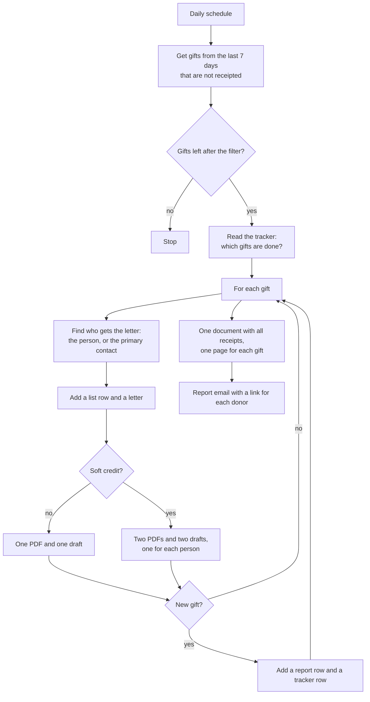

# 01 · Daily donation receipts

**Before:** A staff member found new gifts in the donor database. Then they typed each receipt letter, saved it as a PDF, wrote an email and attached the PDF. They did this for each gift.

**After:** The flow runs each morning. It makes all the letters, one PDF for each donor and one email draft for each donor. It sends one report. The report has an **Open email** link for each donor. The staff member checks each draft and clicks Send.



## How it works

**A letter to an organization goes to a person.** The flow reads the relationships of the organization. It keeps the contacts and uses the primary contact. If there is no primary contact, it uses the first contact. It adds the title of the contact to the address.

**Soft credits do not need edits.** One party pays and a different person gets the credit. A person must choose who gets the receipt. The flow makes one receipt and one draft for each party. The report row tells the staff member to send only one.

```text
Letter_soft = setProperty(setProperty(setProperty(setProperty(
                outputs('Letter_donor'),
                'Donor Name',     <soft-credit name>),
                'Donor Address',  join(<soft-credit street lines>, '\n')),
                'City State Zip', <soft-credit city line>),
                'Salutation',     <soft-credit salutation>)
```

The flow changes four fields in one letter object. The same template then fills both letters.

**One template does two jobs.** The template puts the full letter in a repeating section. The flow sends all letters to make the batch file. It sends one letter to make each PDF.

**No gift gets two emails.** A gift stays "not receipted" until a person marks it in the database. So the gift can come back for 7 days. A tracker records each gift that goes into a report. The flow reads the tracker first. It makes drafts only for new gifts.

**File names are safe.** Each PDF name is `<gift id> - <name>.pdf`. The flow removes the characters that cloud storage does not accept.

**Locked files do not stop the run.** A new file can stay locked for some minutes. The steps that make the files try again every 2 minutes.

**Tests are safe.** One parameter sends every draft to the builder. The test uses real data, but no donor gets an email.

## Parts, by role
Donor database · document template · PDF conversion · cloud spreadsheet for the list and the tracker · email drafts · scheduled flow
