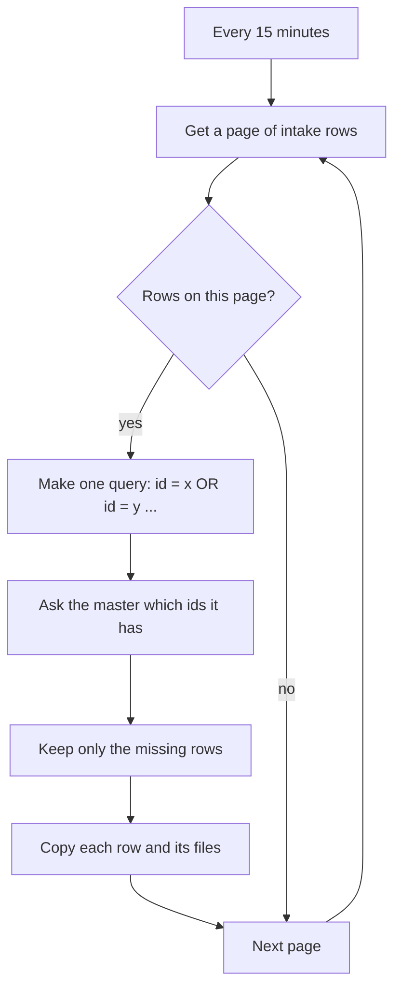

# 02 · Signed forms to master database

**Before:** A person copied each completed, signed form from an intake table into the master database. They also copied the attached files.

**After:** The flow runs every 15 minutes. It reads all pages of the intake table. It asks the master which records it has. It copies only the missing records and their files.

## How it works

**One query for each page.** The flow puts all the ids from one page into one `OR` filter. It asks the master one time. Fifty records need one query, not fifty.

**The flow reads all pages.** A `Do until` loop follows the "next page" value until there is no next page. No record stays on page two.

**Files go by link.** The flow sends only the URL and the file name of each file. The master gets the files itself. The flow does not download them.

**The flow can run many times.** The master records which rows are copied. The flow keeps no data of its own. Ten runs in a row give the same master table.

## Parts, by role
Low-code database API on both sides · scheduled flow
