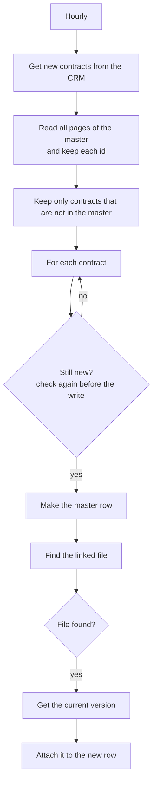

# 03 · CRM contracts to master database

**Before:** A person typed each new contract from the CRM into the master database. Then they found the signed PDF in the CRM and attached it.

**After:** The flow runs every hour. It gets new contracts from the CRM. It reads all ids in the master. It copies only the new contracts. It attaches the current version of the PDF when there is one.

## How it works

**Two checks stop duplicates.** The flow reads all ids in the master and removes the known contracts. Then it checks each contract again just before the write. The second check stops duplicates when two runs overlap.

**The flow gets the correct PDF.** A contract can have many file versions. The flow goes from the record to the document to the current version. It gets only that version.

**Each step has a clear name.** For example: `Ask_master_what_it_already_has`, `Only_the_ones_we_do_not_have`, `Attach_the_PDF_if_there_is_one`. The run history is easy to read.

## Parts, by role
CRM query and API · low-code database API · scheduled flow
