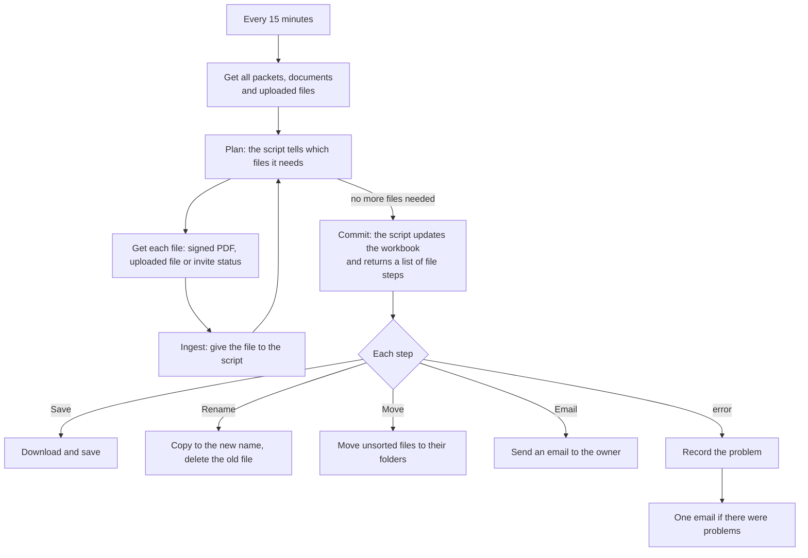

# 04 · Contractor pay engine

**Before:** A desktop script checked contractor paperwork and payments. It ran only when one PC was on.

**After:** A cloud flow and a spreadsheet script do the work. The script makes the decisions. The flow gets, saves, renames and moves the files, and sends the emails. No PC must be on.

## How it works

**The script plans. The flow acts.** The decision logic is a TypeScript spreadsheet script. You can test it and compare versions. The flow asks the script which files it needs. The flow gets the files and gives them to the script. The flow does this until the script needs no more files. Then the script returns a list of steps: `Save`, `Rename`, `Move` and `Email`. The flow does each step.

**The loop has a limit.** The flow counts the rounds. The `Do until` loop has a limit. An error in the logic cannot make the run go on without end.

**Each step has its own scope.** If a step fails, the flow records the problem and goes to the next step. One bad file does not stop the run. The owner gets one email with all problems.

**A test copy uses fake data.** A second copy of the flow reads a fake data file and a test folder. It uses the same script and the same steps. You can test a change from start to end before you turn on the live flow.

**Status:** The test copy passed from start to end. The live flow is ready and turned off until go-live.

## Parts, by role
E-signature platform API · document library · spreadsheet script (TypeScript) · email · scheduled flow and a manual test copy
