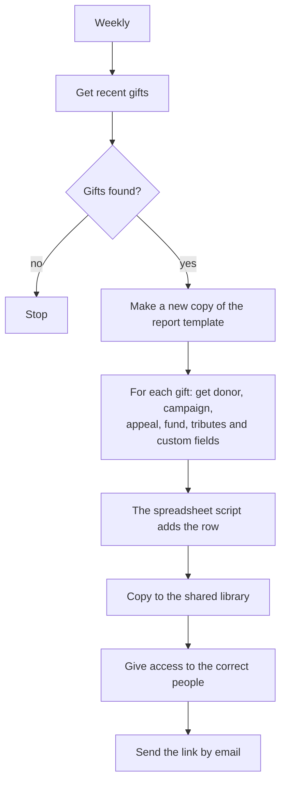

# 05 · Weekly giving digest

**Before:** A person exported the gifts of the week. They found each donor, campaign and fund. They pasted the data into a report template and sent a link by email.

**After:** The flow runs one time each week. It gets the recent gifts and adds the full details to each gift. A spreadsheet script writes the rows into a new copy of the template. The flow shares the file and sends the link. If there are no gifts, the flow sends no email.

## How it works

**The flow adds names to the ids.** The gift list has mostly ids. The flow changes each id to a name that staff can read. It puts soft-credit names and tribute names into lists. So a gift with three honorees is still one row.

**A script writes the rows.** The spreadsheet script writes all rows. This keeps the format the same and is faster than one connector call for each row.

**The flow shares the file.** The flow copies the file to a shared library. Then it gives access to the people who need it.

**No gifts, no file.** If there are no gifts, the flow stops before it makes a file.

## Parts, by role
Donor database · cloud spreadsheet and spreadsheet script · document library · email · scheduled flow
